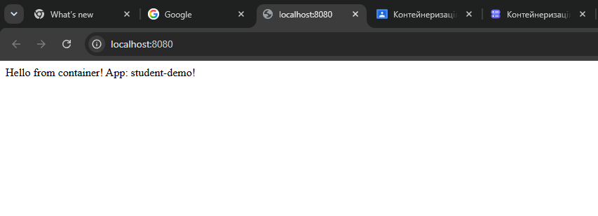

# Звіт до лабораторної роботи: Контейнеризація мінімального веб-сервісу (Docker/Podman)

## Мета контейнеризації та її переваги
Метою роботи є вивчення базових принципів контейнеризації за допомогою **Docker**, створення власного Dockerfile для вебзастосунку на Python (Flask), збірка образу та запуск ізольованого контейнера.

### Переваги контейнеризації:
- Ізоляція середовища виконання від хост-системи.
- Гарантія однакової роботи застосунку на будь-якому комп'ютері.
- Легкість масштабування та розгортання.

## Виконані етапи
1. **Розробка застосунку:** Створено мінімальний вебсервер на Python із використанням фреймворку Flask (`app.py` та `requirements.txt`).
2. **Конфігурація Dockerfile:** Створено інструкцію для збірки на базі легкого образу `python:3.12-slim`.
3. **Збірка образу:** Зібрано контейнерний образ за допомогою команди `docker build`.
4. **Запуск контейнера:** Запущено контейнер із прокиданням портів, передачею змінної середовища `APP_NAME` та підключенням тому.
5. **Перевірка:** Проведено тестування роботи сервісу через браузер.

## Приклади використаних команд
- Збірка образу:
  ```bash
  docker build -t yurka0840/app:1.0 .
- Запуск контейнера:
  ```bash
  docker run -d -p 8080:8080 -e APP_NAME=student-demo -v app_logs:/app/logs --name my-web-app yurka0840/app:1.0

## Результати перевірки
Після успішного запуску контейнера та звернення за адресою `http://localhost:8080` через браузер, вебсервер коректно обробив запит і вивів на екран передану змінну середовища та рядок: `Hello from container! App: student-demo`

## Висновок
Під час виконання лабораторної роботи я ознайомився з принципами створення Dockerfile, навчився збирати контейнерні образи, керувати портуванням мережі, передавати змінні середовища та працювати з томами.
Крім того, для успішного запуску Docker Desktop на системі було виконано оновлення та налаштування підсистеми WSL (Windows Subsystem for Linux) та служби Virtual Machine Platform.